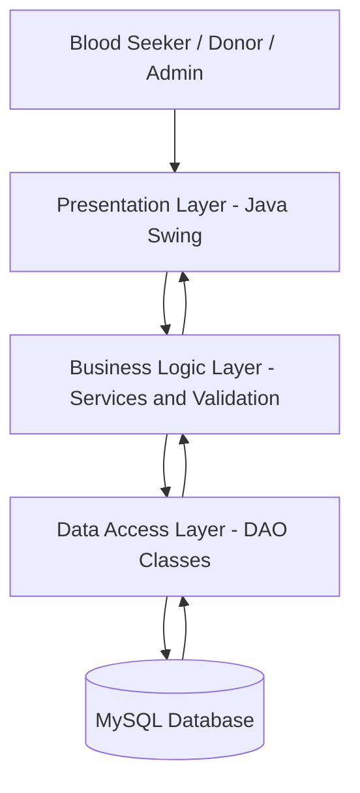
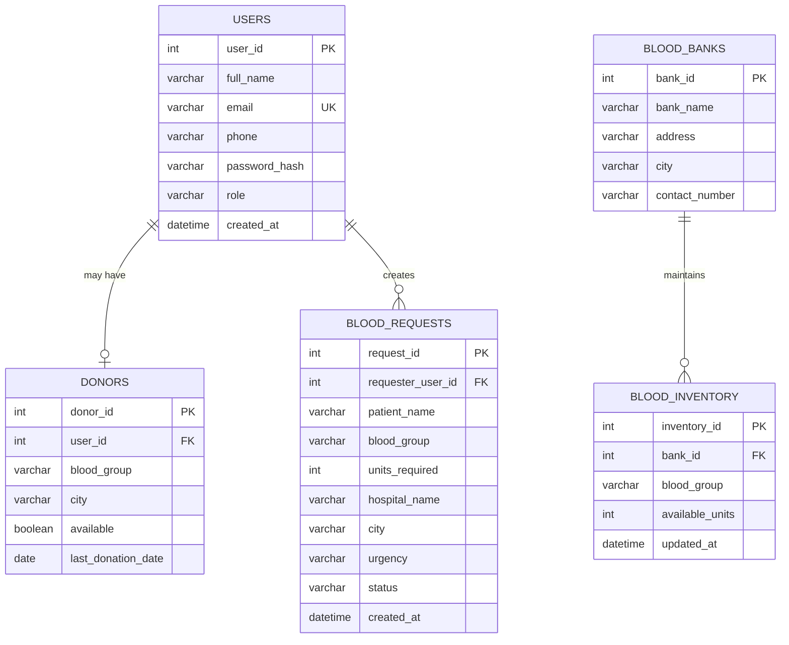

# BloodLink – Emergency Blood Availability Network
## Technical Documentation

**Project type:** Java desktop application  
**Domain:** Application Development / Database Management  
**Proposed stack:** Java, Java Swing, JDBC, MySQL  
**Status:** Implemented (see README.md). Schema additions: `blood_requests.contact_phone`, `blood_inventory.source`.

---

## 1. Project Overview

BloodLink is a Java-based desktop application intended to help people locate potential blood donors and access blood-bank contact and inventory information during medical emergencies. It provides a centralized interface for donor registration, donor searching, emergency blood-request submission, and administrative management.

BloodLink supports information discovery and communication. It does not replace hospitals, licensed blood banks, laboratory testing, medical advice, or clinical transfusion procedures.

### 1.1 Problem Statement

During an urgent medical situation, patients and their families may struggle to identify potential donors or find relevant blood-bank information quickly. Information can be spread across personal contacts, informal groups, and separate organizations. BloodLink proposes a structured system where donor profiles and blood requests can be recorded and searched from one application.

### 1.2 Objectives

- Provide registration and login for application users.
- Allow donors to maintain profiles and update availability.
- Search potential donors by blood group and location.
- Submit and track emergency blood requests.
- Maintain blood-bank contact information.
- Provide administrative tools for managing records.
- Demonstrate Java OOP, Swing, JDBC, SQL, and exception handling.

### 1.3 Scope

The initial version is a desktop application connected to a MySQL database. It includes user authentication, donor management, donor search, emergency requests, blood-bank information, and administrative functions.

Live GPS tracking, automatic SMS delivery, a public web/mobile application, hospital-system integration, and automated medical approval are outside the initial scope and may be considered future enhancements.

---

## 2. Users and Roles

| Role | Main permissions |
|---|---|
| Blood seeker | Register/login, search potential donors, submit requests, view own request status |
| Donor | Maintain donor profile, update availability, view relevant information |
| Administrator | Manage user accounts, donor records, requests, and blood-bank information |

Access to operations must be checked in application logic. Hiding a button alone is not sufficient access control.

---

## 3. Functional Requirements

- **FR-01 Registration:** Users can register with name, email, phone, password, and role. Donor registration also collects blood group, city, and availability.
- **FR-02 Login/logout:** Registered users can authenticate and access the dashboard appropriate to their role.
- **FR-03 Donor profile:** Donors can view and update their profile and availability.
- **FR-04 Donor search:** Seekers can search potential donors by blood group and location.
- **FR-05 Emergency request:** Users can submit a request with blood group, units required, hospital, location, urgency, and contact details.
- **FR-06 Request tracking:** Authorized users can view and update request status.
- **FR-07 Blood-bank directory:** Users can view blood-bank names, addresses, cities, and contact numbers.
- **FR-08 Administration:** Administrators can manage users, donors, requests, and blood-bank records.
- **FR-09 Validation:** The application validates required fields, formats, and numeric values and handles database errors.

Suggested request statuses: `PENDING`, `IN_PROGRESS`, `FULFILLED`, and `CANCELLED`.

---

## 4. Non-Functional Requirements

- **Usability:** Screens should be consistent, readable, and easy to navigate.
- **Performance:** Common searches and record operations should complete within a reasonable time for the expected project dataset.
- **Reliability:** Use database transactions when multiple related changes must succeed together.
- **Security:** Never store plain-text passwords; use parameterized SQL statements.
- **Maintainability:** Separate UI, business logic, and database-access code.
- **Data integrity:** Use primary keys, foreign keys, uniqueness constraints, and validation.
- **Privacy:** Collect only necessary personal data and restrict access to contact details.

---

## 5. System Architecture

BloodLink follows a layered architecture. Each layer has a separate responsibility, keeping the user interface separate from business rules and SQL operations.



### 5.1 Presentation Layer

Built with Java Swing. It contains login, registration, dashboards, forms, tables, search screens, and dialogs. Event listeners respond to user actions and call service methods.

### 5.2 Business Logic Layer

Contains application rules such as validating donor profiles, checking search criteria, creating requests, and checking user permissions. It should not contain Swing components or raw SQL statements.

### 5.3 Data Access Layer

Contains Data Access Object (DAO) classes. Each DAO performs database operations using JDBC and prepared statements. Examples include `UserDAO`, `DonorDAO`, `BloodRequestDAO`, and `BloodBankDAO`.

### 5.4 Database Layer

MySQL stores user accounts, donor profiles, blood requests, and blood-bank records. Relationships and constraints help maintain consistent data.

### 5.5 Typical Request Flow

1. A user enters criteria in a Swing screen.
2. The screen calls a method in the relevant service class.
3. The service validates input and applies business rules.
4. The service calls a DAO method.
5. The DAO executes a parameterized SQL query through JDBC.
6. The DAO returns model objects or an operation result.
7. The screen displays the result or an appropriate message.

---

## 6. Proposed Project Folder Structure

```text
BloodLink/
├── src/
│   └── com/bloodlink/
│       ├── Main.java
│       ├── config/
│       │   └── DatabaseConnection.java
│       ├── model/
│       │   ├── User.java
│       │   ├── Donor.java
│       │   ├── BloodRequest.java
│       │   └── BloodBank.java
│       ├── dao/
│       │   ├── UserDAO.java
│       │   ├── DonorDAO.java
│       │   ├── BloodRequestDAO.java
│       │   └── BloodBankDAO.java
│       ├── service/
│       │   ├── AuthService.java
│       │   ├── DonorService.java
│       │   ├── RequestService.java
│       │   └── SearchService.java
│       ├── ui/
│       │   ├── LoginFrame.java
│       │   ├── RegistrationFrame.java
│       │   ├── SeekerDashboard.java
│       │   ├── DonorDashboard.java
│       │   ├── AdminDashboard.java
│       │   ├── DonorSearchPanel.java
│       │   └── RequestForm.java
│       └── util/
│           └── InputValidator.java
├── database/
│   └── schema.sql
├── lib/
│   └── mysql-connector-j.jar
└── README.md
```

The exact file layout may be adjusted during implementation. Keep responsibilities separated even if the final project uses fewer files.

---

## 7. Database Design

**Database name:** `bloodlink_db`

### 7.1 Entity Relationship Diagram



### 7.2 Table Description

| Table | Purpose |
|---|---|
| `users` | Login identity, contact details, and role |
| `donors` | Donor-specific information linked to a user |
| `blood_requests` | Requests submitted by users |
| `blood_banks` | Blood-bank directory information |
| `blood_inventory` | Optional stock records maintained by authorized staff |

### 7.3 Proposed MySQL Schema

```sql
CREATE DATABASE bloodlink_db;
USE bloodlink_db;

CREATE TABLE users (
    user_id INT AUTO_INCREMENT PRIMARY KEY,
    full_name VARCHAR(100) NOT NULL,
    email VARCHAR(120) NOT NULL UNIQUE,
    phone VARCHAR(20) NOT NULL,
    password_hash VARCHAR(255) NOT NULL,
    role ENUM('SEEKER', 'DONOR', 'ADMIN') NOT NULL,
    created_at TIMESTAMP DEFAULT CURRENT_TIMESTAMP
);

CREATE TABLE donors (
    donor_id INT AUTO_INCREMENT PRIMARY KEY,
    user_id INT NOT NULL UNIQUE,
    blood_group VARCHAR(3) NOT NULL,
    city VARCHAR(100) NOT NULL,
    available BOOLEAN DEFAULT TRUE,
    last_donation_date DATE,
    FOREIGN KEY (user_id) REFERENCES users(user_id)
        ON DELETE CASCADE
);

CREATE TABLE blood_requests (
    request_id INT AUTO_INCREMENT PRIMARY KEY,
    requester_user_id INT NOT NULL,
    patient_name VARCHAR(100) NOT NULL,
    blood_group VARCHAR(3) NOT NULL,
    units_required INT NOT NULL,
    hospital_name VARCHAR(150) NOT NULL,
    city VARCHAR(100) NOT NULL,
    urgency ENUM('LOW', 'MEDIUM', 'HIGH', 'CRITICAL') NOT NULL,
    status ENUM('PENDING', 'IN_PROGRESS', 'FULFILLED', 'CANCELLED')
        DEFAULT 'PENDING',
    created_at TIMESTAMP DEFAULT CURRENT_TIMESTAMP,
    FOREIGN KEY (requester_user_id) REFERENCES users(user_id),
    CHECK (units_required > 0)
);

CREATE TABLE blood_banks (
    bank_id INT AUTO_INCREMENT PRIMARY KEY,
    bank_name VARCHAR(150) NOT NULL,
    address VARCHAR(255) NOT NULL,
    city VARCHAR(100) NOT NULL,
    contact_number VARCHAR(20) NOT NULL
);

CREATE TABLE blood_inventory (
    inventory_id INT AUTO_INCREMENT PRIMARY KEY,
    bank_id INT NOT NULL,
    blood_group VARCHAR(3) NOT NULL,
    available_units INT NOT NULL DEFAULT 0,
    updated_at TIMESTAMP DEFAULT CURRENT_TIMESTAMP
        ON UPDATE CURRENT_TIMESTAMP,
    FOREIGN KEY (bank_id) REFERENCES blood_banks(bank_id)
        ON DELETE CASCADE,
    UNIQUE (bank_id, blood_group),
    CHECK (available_units >= 0)
);
```

**Implementation notes:** MySQL versions before 8.0.16 may not enforce `CHECK` constraints. Validate values in Java as well. Inventory data should be shown with its source and last-updated time. Do not present sample or stale inventory as live availability.

---

## 8. Java Class Design

| Class | Responsibility |
|---|---|
| `User` | Common user details and role |
| `Donor` | Donor-specific information |
| `BloodRequest` | Represents an emergency request |
| `BloodBank` | Represents a blood bank |
| `DatabaseConnection` | Creates JDBC connections |
| `UserDAO` | Reads and writes user records |
| `DonorDAO` | Reads and writes donor records |
| `BloodRequestDAO` | Manages request records |
| `BloodBankDAO` | Manages blood-bank records |
| `AuthService` | Registration and authentication rules |
| `DonorService` | Donor profile and availability rules |
| `SearchService` | Donor search and filtering |
| `RequestService` | Request creation and status rules |
| `InputValidator` | Reusable input validation |
| `Main` | Application entry point |

### 8.1 Object-Oriented Programming Concepts

- **Encapsulation:** Keep model fields private and expose controlled methods.
- **Inheritance:** A common `User` class may be extended by role-specific classes where appropriate.
- **Abstraction:** Use interfaces or abstract classes to define common operations.
- **Polymorphism:** Use overridden methods or interface implementations for role-specific behavior.

Use inheritance only where there is a genuine “is-a” relationship. The database role field remains the source of account-role information.

---

## 9. JDBC and Database Connectivity

The application will use MySQL Connector/J as its JDBC driver.

Example connection configuration:

```java
String url = "jdbc:mysql://localhost:3306/bloodlink_db";
String username = "root";
String password = System.getenv("BLOODLINK_DB_PASSWORD");

Connection connection =
    DriverManager.getConnection(url, username, password);
```

Do not commit real database passwords to source control. Configure credentials locally using environment variables or a private configuration file excluded from version control.

### Database Access Guidelines

- Use `PreparedStatement` for queries containing user input.
- Use try-with-resources to close connections, statements, and result sets.
- Catch `SQLException` and show a user-friendly message.
- Never concatenate raw user input into SQL.
- Use transactions for operations that update multiple related records.
- Keep SQL inside DAO classes rather than Swing event handlers.

Example donor search query:

```sql
SELECT u.full_name, u.phone, d.blood_group, d.city
FROM donors d
JOIN users u ON u.user_id = d.user_id
WHERE d.blood_group = ?
  AND d.city = ?
  AND d.available = TRUE;
```

The DAO should bind the blood group and city through `PreparedStatement` parameters.

---

## 10. User Interface Design

Proposed Swing screens:

1. **Login Screen:** Email, password, login button, and registration navigation.
2. **Registration Screen:** User details, role selection, and donor details when applicable.
3. **Seeker Dashboard:** Search donors, create requests, and view request history.
4. **Donor Dashboard:** View and update donor profile and availability.
5. **Donor Search Screen:** Blood-group and city filters with matching results.
6. **Emergency Request Form:** Patient, blood group, units, hospital, city, and urgency.
7. **Blood Bank Screen:** Blood-bank directory and, if implemented, inventory details.
8. **Admin Dashboard:** Manage users, donors, requests, and blood-bank records.

Possible Swing components include `JFrame`, `JPanel`, `JLabel`, `JTextField`, `JPasswordField`, `JComboBox`, `JButton`, `JTable`, and `JOptionPane`.

Long-running database operations should not run on the Swing Event Dispatch Thread. Use `SwingWorker` if searches or other operations may take noticeable time, and update Swing components on the Event Dispatch Thread.

---

## 11. Main Application Workflows

### 11.1 Donor Registration

1. User selects the donor role.
2. User enters account and donor information.
3. The application validates required fields and formats.
4. The service securely hashes the password.
5. The DAO inserts the user and donor profile in a database transaction.
6. The application confirms registration or displays an error.

### 11.2 Donor Search

1. User opens the donor search screen.
2. User selects a blood group and enters a city.
3. The service validates the search fields.
4. The DAO retrieves matching available donor records.
5. The application displays the results.

A search result identifies a **potential donor**, not a medically approved match. Donor availability, eligibility, compatibility, and transfusion suitability must be confirmed by qualified professionals.

### 11.3 Emergency Request

1. User enters the request details.
2. The application validates the fields and units required.
3. The request service creates a request with `PENDING` status.
4. The DAO saves the request.
5. The user receives confirmation and can view its status.

### 11.4 Request Status Update

1. An authorized administrator opens a request.
2. The administrator selects an allowed new status.
3. The service checks authorization and valid status transition.
4. The DAO updates the record.
5. The updated status is displayed.

---

## 12. Security, Privacy, and Safety

- Store password hashes, never plain-text passwords. Use a well-established password-hashing algorithm such as Argon2id or bcrypt through a suitable Java library.
- Use prepared statements to reduce SQL-injection risk.
- Validate user input and enforce database constraints where possible.
- Restrict administrator operations to administrator accounts.
- Do not expose donor phone numbers or other personal details without an appropriate consent and access policy.
- Collect only the personal data needed and protect database credentials.
- Treat donor availability as self-reported and potentially out of date.
- Do not use the application to determine clinical blood compatibility or authorize transfusions. Blood grouping, crossmatching, donor eligibility, and release of blood must be handled by qualified medical professionals and authorized blood banks.
- Blood-bank inventory must be labelled with its source and last-updated time.

---

## 13. Testing Plan

| Test area | Example test |
|---|---|
| Registration | Valid registration and duplicate email |
| Login | Correct password, incorrect password, unknown account |
| Input validation | Empty fields, invalid phone, invalid units |
| Donor search | Matching blood group/city; no matching donor |
| Availability | Available and unavailable donor |
| Emergency request | Valid request and zero/negative units |
| Request tracking | Authorized and unauthorized status update |
| Database | Database unavailable and invalid connection settings |
| Security | SQL-injection-style input and role-access checks |
| Data integrity | Foreign-key and unique-constraint checks |

Use synthetic test records during development. Do not populate the demonstration database with real personal or medical information without authorization.

---

## 14. Setup and Execution

### Prerequisites

- A supported Java Development Kit (JDK).
- MySQL Server and a MySQL client.
- MySQL Connector/J JDBC driver.
- Visual Studio Code with Java support, or another Java IDE.

### Initial Setup

1. Install and verify the JDK using `java -version` and `javac -version`.
2. Install and start MySQL Server.
3. Create the `bloodlink_db` database by executing `database/schema.sql`.
4. Add MySQL Connector/J to the project's classpath or build configuration.
5. Configure the database URL, username, and password locally.
6. Build the Java project and run `com.bloodlink.Main`.

Exact build and run commands depend on whether the project uses a simple VS Code Java project, Maven, or Gradle. Document the selected method in the final README.

---

## 15. Limitations

- The initial application is a desktop application and requires access to the configured database.
- Donor information and availability depend on users keeping their profiles updated.
- Search results do not guarantee that a donor is reachable, eligible, or medically compatible.
- Blood-bank information and inventory are only as reliable as their authorized data source and update frequency.
- The initial version does not provide automated SMS, GPS, or mobile notifications unless those features are separately implemented.

---

## 16. Future Enhancements

- Develop a web and mobile version for broader access.
- Add GPS-based location search with user permission.
- Integrate SMS or email notifications through an authorized service.
- Provide verified blood-bank and hospital integrations.
- Add donor reminders and consent-based communication.
- Introduce audit logs and administrative reports.
- Add multilingual interface support.

---

## 17. Expected Outcome

The expected outcome is a functional Java Swing application connected to a MySQL database. It will support user registration and login, donor profile management, donor search by blood group and location, emergency blood-request management, blood-bank information, and administrative operations.

The project will demonstrate practical use of Java object-oriented programming, event-driven GUI development, JDBC, SQL, validation, and exception handling.

---

## 18. Conclusion

BloodLink proposes a structured digital platform to make potential blood donors and blood-bank information easier to locate during emergencies. By combining a Java Swing interface with JDBC and MySQL, the project demonstrates how core Java and database concepts can be applied to a practical social-support use case. Its role is to assist information discovery and communication while leaving all clinical decisions and transfusion procedures to qualified healthcare professionals.

---

**Document note:** This document describes the proposed design and intended functionality. Features should be marked as completed only after they have been implemented and tested.
